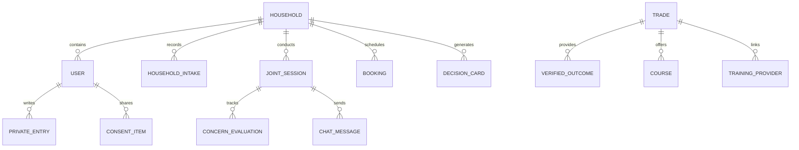
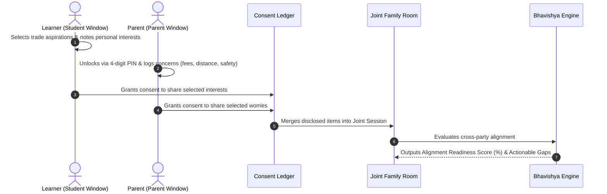
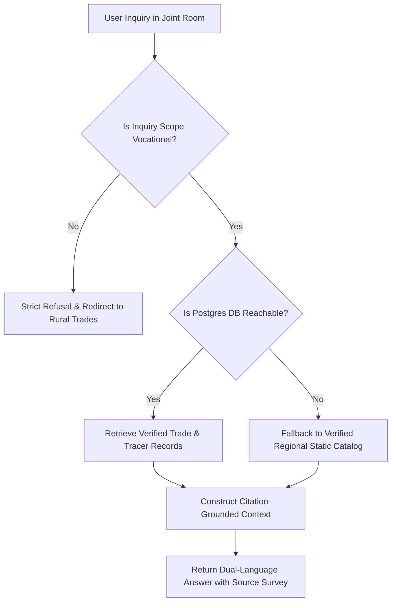
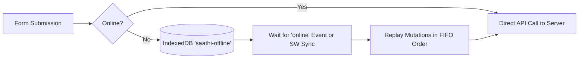

# SAATHI Technical Architecture Specification

This document details the architectural principles, data flow models, domain subsystems, and security models underpinning **SAATHI (साथी)** — an AI-guided vocational guidance platform built for the Smart India Hackathon 2026 (Problem Statement 262241).

---

## 1. Architectural Philosophy

Rural vocational decision-making in India is inherently a **multi-stakeholder household negotiation**. Unlike western individual-centric career guidance platforms, SAATHI is architected around three foundational invariants:

1. **Psychological Safety Before Joint Negotiation**: Students need freedom to explore without fear of immediate parental disapproval. Parents need a private space to voice genuine anxieties (e.g., migration safety, immediate family income needs) without dampening their child's motivation.
2. **Grounded Empirical Truth Over Generative Hallucination**: AI suggestions must cite verified regional data (NCVET periodic tracer surveys, DGT certificates, NAPS schemes) and show median starting wages—never skewed averages or unverified marketing promises.
3. **Resilience to Rural Infrastructure Realities**: Low connectivity (2G/3G edge networks), spotty electricity, and varying literacy levels must not break core functionality. Offline mutation queuing, voice guidance, and 16 kbps audio fallbacks are first-class architecture primitives.

---

## 2. Monorepo Organization & Package Boundaries

SAATHI is constructed as a strict TypeScript monorepo using npm workspaces:

```
saathi/
├── packages/
│   └── shared/                  # Single Source of Truth: DTOs, Zod validation schemas, domain types
│       ├── src/
│       │   ├── schemas/         # Runtime validation schemas (auth, intake, trades, counselling, admin)
│       │   └── types/           # Exported TypeScript interfaces and enums
│       └── dist/                # Pre-compiled JS and type declaration files
└── apps/
    ├── api/                     # Node.js + Express.js backend API
    │   ├── src/
    │   │   ├── config/          # Environment validation & Pino logger
    │   │   ├── controllers/     # Route handlers & request translation
    │   │   ├── lib/             # Shared utilities (Prisma client, WebRTC signaling, error envelopes)
    │   │   ├── middleware/      # JWT authentication, role RBAC, Zod validation
    │   │   ├── routes/          # Express route bindings
    │   │   └── services/        # Business logic (Bhavishya engine, Grounded AI, Admin k-anon)
    │   └── prisma/              # PostgreSQL schema definition, migrations, seed script
    └── web/                     # Vite + React 18 single page application
        ├── src/
        │   ├── app/             # Router, ErrorBoundary, global providers
        │   ├── components/      # UI component library, layout, Hearth design system
        │   ├── features/        # Domain features (auth, intake, trades, joint-room, counselling)
        │   ├── lib/             # API client, i18n, offline IndexedDB queue, Web Speech adapter
        │   ├── locales/         # Bilingual en.json and hi.json localization dictionaries
        │   ├── pages/           # Top-level view routes
        │   ├── stores/          # Zustand client state stores (session, ui)
        │   └── styles/          # Hearth design tokens, CSS variables, tailwind configuration
        └── e2e/                 # Playwright end-to-end smoke and responsive test suites
```

---

## 3. Data Model & Prisma Schema

The PostgreSQL database (managed via Prisma ORM) models the lifecycle of family vocational counselling:



### Core Domain Entities:
- **`Household`**: Represents the family unit, anchored by district, state, income band, and demographic category.
- **`User`**: Family members categorized by role (`LEARNER`, `PARENT`, `COUNSELLOR`, `ADMINISTRATOR`).
- **`HouseholdIntake`**: Baseline survey collecting student class level, academic stream, primary financial constraints, and parent occupation.
- **`Trade` & `VerifiedOutcome`**: Regional vocational catalog with NSQF levels (1–8), durations, and periodic tracer study metrics (`medianSalaryStarting`, `medianSalaryAfter3Yrs`, `placementRate`).
- **`Booking`**: Escalated live counselling appointments with state progression (`REQUESTED`, `CONFIRMED`, `COMPLETED`, `CANCELLED`).
- **`DecisionCard`**: The final signed agreement certifying the family's chosen trade, nearby government ITI provider, and SHA-256 session integrity seal.

---

## 4. Core Subsystem Architectures

### A. The Three-Window Family Architecture


1. **Student Window**: Gives the learner private agency to explore without surveillance.
2. **Parent Window**: Secured by an explicit user-initiated PIN lock preventing accidental learner viewing.
3. **Consent Ledger**: Any item shared to the Joint Room requires explicit opt-in; unshared items remain strictly confidential.

### B. Bhavishya Synthesis Engine
The Bhavishya engine calculates the **Family Readiness Score ($R$)**:

$$R = 100 - \sum_{i=1}^{n} w_i \cdot \max(0, \text{Severity}_i - \text{Resolution}_i)$$

Where:
- $w_i$ is the category weight (e.g., Financial Worry: $1.2$, Placement Guarantee: $1.0$, Social Stigma: $0.8$).
- $\text{Severity}_i$ is the initial parent/learner concern rating ($1–5$).
- $\text{Resolution}_i$ is the mutually agreed mitigation level ($1–5$).

When $R \ge 70\%$, the platform unlocks the generation of an official **Decision Card**. If $R < 70\%$, the platform actively prompts the family to escalate to a certified human counsellor.

### C. Grounded AI & Anti-Hallucination Retrieval
The AI service adheres to strict ground-truth verification:



- **Zero Hallucination Guarantee**: The model only generates responses containing verified citations from official NCVET tracer studies.
- **Fail-Safe Resilience**: If the database server is unreachable or offline, the retrieval pipeline seamlessly falls back to the embedded static regional catalog without crashing.

### D. WebRTC Live Consultation with 16 kbps Audio Fallback
Live consultations connect households to certified government vocational counsellors:
- **Signaling**: WebSocket-based SDP offer/answer exchange through `/socket.io`.
- **Media**: Peer-to-peer WebRTC video stream with STUN/TURN fallback.
- **Graceful Rural Degradation**: When network monitoring detects high packet loss or 2G/3G cellular links, the user or counsellor can switch with 1-click to a dedicated **16 kbps Opus audio-only stream**, disabling video track transmission and minimizing data consumption.

### E. K-Anonymity Admin Policy Engine
The Administrator Dashboard aggregates state and district vocational insights while protecting citizen privacy:
- **$k$-Anonymity Constraint ($k \ge 10$)**: Any demographic bucket, district cluster, or trade cohort with fewer than 10 respondents is automatically suppressed (`null` value with `suppressed: true` flag).
- **Sentiment Shifts**: Measures pre-counselling vs. post-counselling concern severity deltas across categories (`FINANCIAL_WORRY`, `JOB_PLACEMENT`, `SOCIAL_STIGMA`).
- **Median Metric Rule**: All income and wage indicators compute medians rather than means to prevent high-earning urban outliers from misleading rural planning.

---

## 5. Offline Sync & Rural Resilience Architecture



1. **Network Detection (`useNetworkStatus`)**: Monitors `navigator.connection` (`effectiveType`) and `navigator.onLine`. Automatically applies `.lite-mode` when the network is `2g` or `slow-2g`.
2. **Offline Mutation Queue (`offlineQueue.ts`)**: When offline, forms (intake, concerns, checkpoint evaluations) serialize into an IndexedDB store (`saathi-offline`).
3. **Background Sync**: Service Worker (`/sw.js`) intercepts network reconnection and triggers `replayOfflineQueue()` to drain the queue in first-in-first-out order.
4. **Speech Adapter**: Bilingual Web Speech API integration provides text-to-speech narration and voice dictation, allowing illiterate or low-literacy family members to participate fully.
