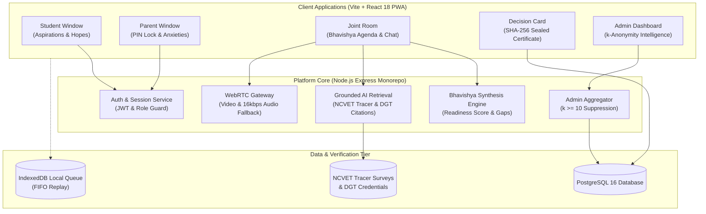

# SAATHI (साथी) — AI-Guided Vocational Counselling Platform for Rural Families

[](https://github.com/sarthak654/Saathi)
[](https://github.com/sarthak654/Saathi)
[](https://www.sih.gov.in)
[](LICENSE)

> **Empowering rural households across India to bridge generational gaps, evaluate verified local ITI/polytechnic career outcomes, and reach shared vocational decisions.**

---

## Overview

In rural and semi-urban India, vocational education decisions are rarely made by the student alone. Parents—often worried about social stigma, safety, hostel distances, and financial stability—clash with students' aspirations. Furthermore, misleading private institute claims and lack of verified district-level wage data lead to dropouts and family conflict.

**SAATHI (साथी)** solves this through:
1. **The Three-Window Family Architecture**: A private Student Window, a private Parent Window (with 4-digit PIN lock), and a collaborative Joint Family Room.
2. **Bhavishya Synthesis Engine**: Automated alignment calculation comparing student desires against parental concerns.
3. **Grounded AI with Verified NCVET/DGT Tracer Data**: Strict anti-hallucination guardrails citing official periodic tracer surveys, median salaries (never skewed averages), and placement rates.
4. **Certified Human Counsellor Escalation**: 1-click WebRTC consultation with low-bandwidth 16 kbps audio-only fallback for 2G/3G connectivity.
5. **Tamper-Evident Family Decision Card**: SHA-256 cryptographic seal linking agreed actions, local government ITIs, and direct SMS delivery.
6. **K-Anonymity Admin Intelligence**: Policy dashboard tracking district distress, concern shifts, and decision funnels with privacy suppression ($k \ge 10$).
7. **Low-Connectivity & Low-Literacy Inclusion**: Auto-Lite mode, service worker caching, IndexedDB offline mutation queue, and bilingual Web Speech voice I/O.

---

## System Architecture



---

## Key Platform Features

### 1. Three-Window Family Model & Private Lock
- **Student Window**: Safe exploration of trade careers, NSQF progression ladders, and video walkthroughs without premature parental critique.
- **Parent Window**: Safe expression of financial worries, family pressure, and safety concerns protected by an explicit PIN lock.
- **Consent Ledger**: Transparent log showing exactly what items each party chose to share into the Joint Room.

### 2. Bhavishya Alignment Engine
- Dynamically analyzes household income, educational eligibility, and mutual concerns.
- Calculates an objective **Family Readiness Score (0–100%)** using medians rather than averages to prevent outlier distortion.
- Highlights unaddressed gaps before committing to an education path.

### 3. Grounded AI Guardrails
- Uses strict zero-temperature citation validation against verified DGT and NCVET trade outcomes.
- Out-of-scope non-vocational inquiries (trivia, medical, elite academic degrees) are refused with constructive redirection to rural vocational skills.

### 4. Certified Live Counsellor Consultation
- Integrated WebRTC video room allowing families to meet certified government counsellors directly inside the platform.
- **Graceful Degradation**: 1-click toggle to 16 kbps Opus audio-only mode designed for rural 2G/3G cellular towers.

### 5. SHA-256 Sealed Decision Card
- Cryptographically signs the family's shared decision with a verifiable SHA-256 session hash.
- Embeds verified nearby Government ITI / NSTI / Polytechnic details (address, principal phone, intake capacity).
- Bilingual SMS summary generator formatted for feature phones.

### 6. Admin Intelligence & K-Anonymity Policy Dashboard
- District and state-level policy dashboard tracking household intakes, concern sentiment shifts, and completion funnels.
- **Strict Privacy**: Sub-cohorts with fewer than 10 respondents ($k < 10$) are automatically suppressed with `SUPPRESSED` indicators.

### 7. Rural Accessibility & Low-Connectivity Hardening
- Automatic detection of 2G/3G networks triggering image-free, animation-free **Lite Mode**.
- IndexedDB mutation queue that buffers submissions offline and automatically syncs when connectivity returns.
- Bilingual Web Speech API voice reader and voice input (Bhashini-ready) for low-literacy users.

---

## Hearth Design System

SAATHI is styled with the **Hearth Design System**, a purpose-built warm earthen palette honoring rural craft and natural clay:

| Token | Hex | Usage |
| :--- | :--- | :--- |
| `--color-primary` (Terracotta) | `#C4562B` | Brand identity, primary CTAs, active states |
| `--color-student` (Marigold / Amber) | `#EFA531` | Student window, aspirations, optimistic states |
| `--color-parent` (Forest / Leaf) | `#2F7D5C` | Parent window, security, consensus states |
| `--color-bg` (Warm Parchment) | `#FFFDF9` | Soft, glare-free background for outdoor viewing |
| `--color-text` (Earthen Umber) | `#3A2E2A` | Accessible high-contrast typography |

- **Zero Purple**: Completely free of generic tech-startup neon/purple accents.
- **Zero Pill Buttons**: Structured squircle geometry (`--radius-btn: 8px`, `--radius-card: 12px`).
- **Accessible Typography**: Serif headings (`Source Serif 4`) paired with clean sans body (`Public Sans`).

---

## Quick Start

For detailed setup instructions, see [START.md](file:///c:/Users/Sarthak/OneDrive/Desktop/Saathi/START.md).

```bash
# 1. Install dependencies
npm install

# 2. Build shared contract library
npm run build --workspace=@saathi/shared

# 3. Start development servers
npm run dev:api    # Express API on port 4000
npm run dev:web    # Vite React on port 3000
```

## Deploy on Render

The repository includes [render.yaml](./render.yaml) for a public demo deployment:

1. Push the repository to GitHub.
2. In Render, choose **New → Blueprint** and select the repository.
3. Render creates:
   - `saathi-api` — free-tier native Node Express API with Socket.IO
   - `saathi-web` — Vite static frontend
   - Neon PostgreSQL — supplied through the API service's `DATABASE_URL` secret
4. In the `saathi-api` service, set `DATABASE_URL` to your Neon connection string, including `sslmode=require`.
5. After the first deploy, copy the actual `saathi-web` URL into the API service's `CORS_ORIGIN`.
6. If Render assigns a URL different from `https://saathi-web.onrender.com`, update `VITE_API_URL` and `VITE_SOCKET_URL` in the web service and redeploy.
7. Set `TRANSLATION_INTERNAL_SECRET` only if a private translation service is configured. The app falls back safely when it is not set.

The Render build commands use `npm ci --include=dev` because TypeScript compilation currently includes API test files and needs the declaration packages. The running service remains production-only at runtime. The API service runs `prisma db push` before starting because this repository currently has no committed Prisma migration directory. Replace this with `prisma migrate deploy` after adding and committing production migrations. Render's free web service can sleep after inactivity, so the first request after idle time may take longer.

---

## Verification & Testing

SAATHI maintains **100% green test coverage** across all monorepo workspaces:

```bash
# Run 87 API unit & integration tests
npm test --workspace=@saathi/api

# Run 92 Web Vitest unit tests
npm test --workspace=@saathi/web

# Run 25 Playwright E2E smoke & responsive tests (320px, 375px, 768px, 1280px)
npm run test:e2e
```

| Suite | Runner | Tests | Status |
| :--- | :--- | :--- | :--- |
| API Backend | Vitest + Supertest | 87 | Passed |
| Web Frontend | Vitest + Testing Library | 92 | Passed |
| Playwright E2E & Smoke | Playwright Chromium | 5 | Passed |
| Responsive Audit (4 viewports) | Playwright Chromium | 20 | Passed |
| **Total Test Suite** | | **204** | **100% Passed** |

---

## Documentation Index

- [START.md](file:///c:/Users/Sarthak/OneDrive/Desktop/Saathi/START.md) — Step-by-step local setup, environment variables, demo accounts
- [ARCHITECTURE.md](file:///c:/Users/Sarthak/OneDrive/Desktop/Saathi/ARCHITECTURE.md) — Technical architecture, state machine, data models, WebRTC, k-anonymity
- [API.md](file:///c:/Users/Sarthak/OneDrive/Desktop/Saathi/API.md) — Complete REST API specification with endpoints, DTOs, and error codes
- [DESIGN.md](file:///c:/Users/Sarthak/OneDrive/Desktop/Saathi/DESIGN.md) — Hearth design system, color tokens, responsive breakpoints, i18n
- [CONTRIBUTING.md](file:///c:/Users/Sarthak/OneDrive/Desktop/Saathi/CONTRIBUTING.md) — Git workflows, branch conventions, PR checklist
- [PROGRESS.md](file:///c:/Users/Sarthak/OneDrive/Desktop/Saathi/PROGRESS.md) — Implementation trajectory across all 9 SIH phases
